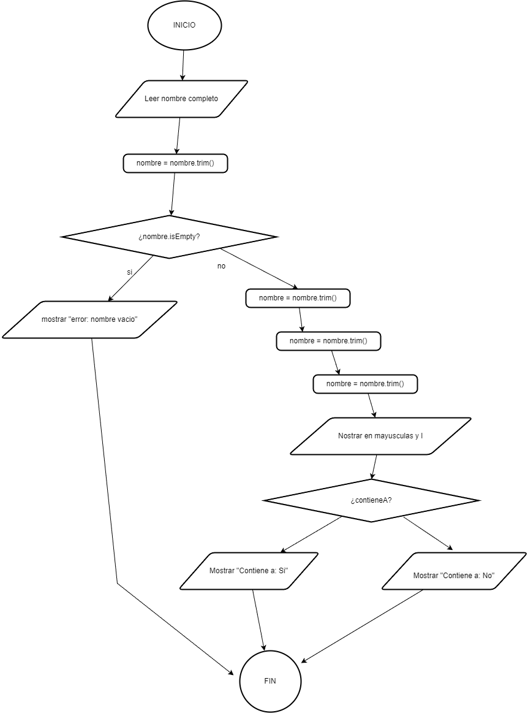
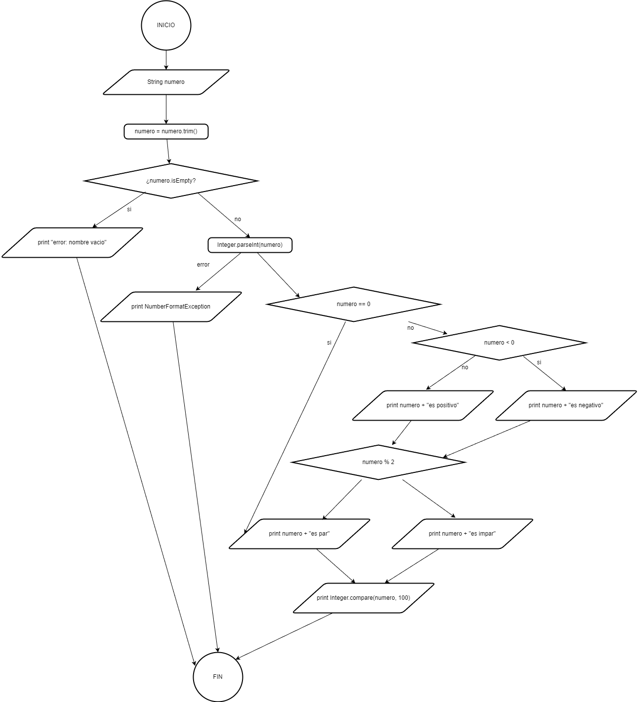
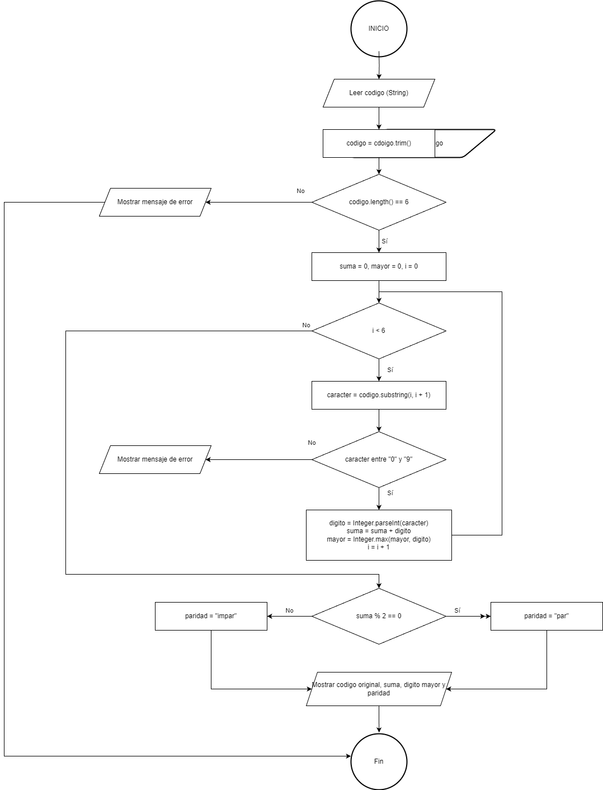

# Tarea 1 — Solución de ejemplo: diagramas de flujo con `String` e `Integer`

**Módulo:** Entornos de Desarrollo (DAM)  
**Unidad 5:** Elaboración de diagramas de comportamiento  
**Herramienta:** [diagrams.io](https://app.diagrams.net/)  
**Repositorio público:** `tarea-1`  
**Autor/a:** Mauro Edi Goller Pérez

> **Modelo orientativo de entrega del alumnado.** Esta es una solución completa de referencia. Los diagramas se han guardado en `diagramas/` con formato `.drawio.png` para visualizarlos en GitHub y reabrirlos en diagrams.io.

## Cómo se construye cada diagrama

1. **Leer el enunciado** y anotar la entrada, las variables y las decisiones.
2. **Pasar el "desarrollo lógico" a cajas**, en el mismo orden.
3. **Usar la forma adecuadapara cada elemento:**
4. **Dejar el camino correcto en vertical** y sacar los errores hacia un lado.
5. **Cada error termina en un mensaje y su propio Fin.**
6. **Los bucles se dibujan en tres partes:** inicialización, condición y cuerpo que termina actualizando el contador, con una flecha de vuelta a la condición.
7. **Probar el diagrama** con una entrada válida y otra inválida.

## Resumen de los ejercicios

### Ejercicio 1, Analizador de nombres
Leer, `trim()`, ¿ est'a vacío? Si lo está, mostrat error. Si no, mostrar mayúsculas, longitud y si contiene la letra `a`.

### Ejercicio 2, Validador y clasificador de números
Leer, `trim()`, ¿está vacío?, ¿`parseInt` válido? Si falla, da error. Si no, clasificar signo, paridad y comparar con 100 usando `Integer.compare()`.

### Ejercicio 3, Analizador de códigos numéricos
Leer, `trim()`, ¿es la longitud 6? Después, bucle `i < 6`: extraer el carácter, comprobar que es dígito, acumular la suma y actualizar el mayor. Al terminar, decidir la paridad de la suma y mostrar los resultados. El código completo nunca se convierte a `int`.

